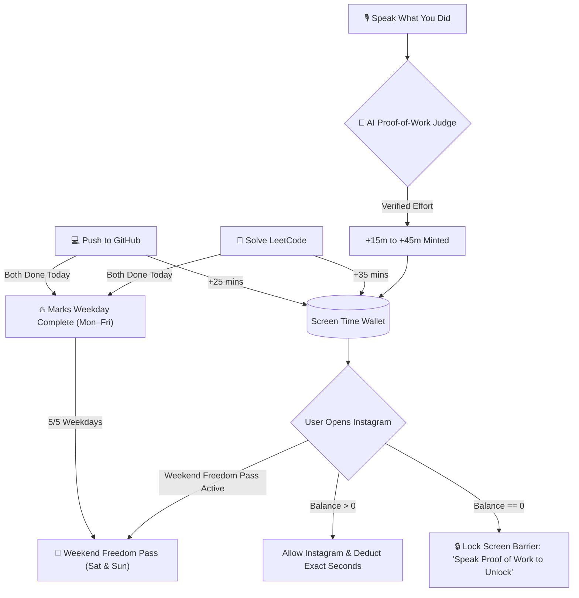

# 🎙️⚡ ProofOfWork

**Speak your Proof of Work. Earn your dopamine. Lock distractions behind verified voice & code.**

A native, zero-battery-drain Android productivity app that blocks social media (Instagram) until you earn screen time by **speaking what you accomplished via Voice Dictation**, **pushing code to GitHub**, **solving LeetCode problems**, and maintaining a **5-Day Weekday Streak for Weekend Freedom**.

[](https://developer.android.com)
[](#)
[](https://ai.google.dev)
[](https://kotlinlang.org)
[](https://developer.android.com/jetpack/compose)

---

## 💡 The Philosophy: "The Voice & Code Screen Time Economy"

Traditional app blockers fail because they rely on rigid schedules or a single *"Ignore for 15 minutes"* button.

**ProofOfWork** turns screen time into an **earned currency**:
* **Say "Hey Productivity" / Tap the Mic:** Trigger the app via the Quick Settings Tile, Voice Assistant shortcut, or right from the Instagram Lock Screen.
* **Speak What You Accomplished:** Dictate naturally using voice input (e.g., *"I just spent 45 minutes refactoring the authentication API and wrote 3 unit tests"*).
* **AI Proof-of-Work Judge:** Our dual-engine verifier (**Google Gemini 2.0 Flash** + **Built-in Semantic AI Engine**) analyzes your explanation, filters out filler words and excuses, categorizes the effort (`CODING`, `STUDY`, `FITNESS`, `DEEP_WORK`), and **mints Instagram minutes** directly into your wallet.
* **5-Day Weekday Streak → Weekend Freedom Pass:** Complete **both GitHub and LeetCode** Monday through Friday (`5/5` weekdays) to unlock **Unrestricted Saturday & Sunday Access**—with a customizable toggle to switch between *Weekend Freedom* and *Strict Daily Mode* anytime.



---

## ✨ Key Features

### 1. 🎙️ "Hey Productivity" Voice Proof-of-Work
* **Hands-Free Launchers:**
  * **Android Quick Settings Tile:** Swipe down from any screen and tap **"🎤 Voice Proof"** to jump straight into voice logging.
  * **Digital Assistant / Voice Command Intent:** Responds to `ACTION_VOICE_COMMAND` & `ACTION_ASSIST` plus long-press App Shortcuts.
  * **Instagram Lock Screen Voice Unlock:** Locked out of Instagram? Tap **"Speak Proof of Work"** right on the barrier, dictate your completed task, and watch the lock screen automatically dismiss as your minutes are minted!

### 2. 🤖 Dual-Engine LLM Proof-of-Work Judge
* **Cloud LLM (Google Gemini 2.0 Flash) + Instant Offline Semantic AI:**
  * Evaluates spoken transcripts to verify genuine task completion and reject non-productive excuses (*"I did nothing"*, *"Watched Netflix"*).
  * Extracts concise task summaries, estimates focus duration, computes confidence scores, and delivers personalized coach feedback.
* **Custom Task → Instagram Minutes Mapping:**
  * Map specific task categories (`Coding`, `Study`, `Fitness`, `Deep Work`) or individual priority tasks to custom Instagram minute rewards (`+10m`, `+15m`, `+25m`, `+45m`). Deletes automatically deduct unspent task rewards.

### 3. 🔥 5-Day Weekday Streak & Weekend Freedom Mode
* **Mon–Fri Progress Tracker (`MON • TUE • WED • THU • FRI`):**
  * A weekday is automatically marked as completed when you complete **both** your daily **GitHub push** and **LeetCode solve** on that day.
* **Customizable Weekend Toggle:**
  * **ON (Weekend Freedom Pass):** Completing all 5 weekdays (`5/5`) automatically grants **Unlimited Instagram Access** on Saturday and Sunday.
  * **OFF (Strict Mode):** Saturday and Sunday behave like normal weekdays requiring daily Proof of Work.
  * Includes a **Demo Simulation Mode** switch in Settings so judges and testers can preview the 5/5 Weekend Freedom state with a single tap!

### 4. 😅 "Voice Accountability Confession" & 📋 EOD Voice Standup
* **5-Minute Guilty Voice Confession:** Need an urgent 5-minute break without working? You must speak out loud why you are pausing focus and promise to return in 5 minutes (limited to once per day).
* **1-Tap EOD Standup Generator:** Compiles all your spoken logs, completed tasks, and coding verifications into a clean daily standup summary ready to copy into Slack, Notion, or Discord.

### 5. 🔋 Zero-Battery Second-Accurate Blocker Architecture
* **WindowManager + Accessibility Hybrid Tracking:** Accurately tracks active Instagram foreground usage down to the exact second (`Xm Ys`) across direct launches, Recent Apps switches, and hands-free Reel watching.
* **Zero Idle Drain:** Uses `SystemClock.elapsedRealtime()` deltas and pauses completely when the screen is off (`0.0%` standby CPU).
* **Atomic Daily Rollover:** Automatically resets daily usage counters and tasks at midnight while preserving your weekly streak.

---

## 🛠️ Tech Stack

| Layer | Technology |
| :--- | :--- |
| **Language** | Kotlin 2.0.21 |
| **Voice & AI** | Android SpeechRecognizer / Voice Input + Google Gemini 2.0 Flash API |
| **UI Framework** | Jetpack Compose (Material Design 3) • Obsidian OLED Bento UI |
| **Architecture** | MVVM + Unidirectional Data Flow (`StateFlow` / Coroutines) |
| **Local Storage** | Jetpack DataStore (Preferences) + Room Database 2.6.1 (`TaskEntity`, `VoiceLogEntity`) |
| **OS Integration** | `AccessibilityService` + `TileService` (Quick Settings) + App Shortcuts |

---

## 🚀 Getting Started: How to Build & Run

### 1. Prerequisites
* **Android Studio** Ladybug (2024.2.1) or newer
* **JDK 17** or newer (bundled with Android Studio)
* **Android SDK 35** (minimum supported device: **Android 8.0 / API 26+**)
* A **physical Android phone** with **USB Debugging** enabled *(recommended for testing the Accessibility Service and Instagram blocker)* or an Android Emulator

---

### 2. Clone the Repository
```bash
git clone https://github.com/<your-username>/Proof-Of-Work.git
cd Proof-Of-Work
```

---

### 3. Build & Install the App

#### **Option A: Run via Android Studio (Recommended)**
1. Open **Android Studio** and select **Open**.
2. Choose the cloned `Proof-Of-Work` project directory.
3. Wait for Gradle sync to finish.
4. Connect your Android phone via USB (with USB Debugging enabled) and click **Run (`▶`)**.

#### **Option B: Run via Command Line (macOS / Linux / Windows)**
```bash
# 1. Compile and install the debug APK directly to your connected device
./gradlew installDebug

# 2. Launch ProofOfWork on your device
adb shell am start -n com.proofofwork/.MainActivity
```
*(On Windows Command Prompt / PowerShell, use `.\gradlew.bat installDebug` or run the included `.\run.ps1` script).*

#### **Option C: Build Standalone APK File**
```bash
./gradlew assembleDebug
```
The installable APK will be generated at:
```text
app/build/outputs/apk/debug/app-debug.apk
```
You can transfer this APK to any Android phone and install it directly, or run:
```bash
adb install -r app/build/outputs/apk/debug/app-debug.apk
```

---

### 4. First-Time App Configuration (On Your Phone)

Once **ProofOfWork** launches on your phone, complete these quick steps in the **Settings** tab:

1. **Enable the Focus Blocker Accessibility Service *(Required for Instagram tracking & locking)*:**
   * Go to the **Settings** tab inside ProofOfWork.
   * On the top **Focus Blocker Service** card, tap **"Open Accessibility Settings"**.
   * Under *Downloaded Apps*, select **ProofOfWork Focus Blocker** and toggle it **ON**.
2. **Connect GitHub & LeetCode *(For automated coding rewards & 5-Day Streak)*:**
   * In the **Settings** tab under **Account Integrations**, enter your **GitHub Username** and **LeetCode Username** (public profiles, no passwords or OAuth tokens required).
   * Tap **Save Configuration**.
3. **Add Gemini API Key *(Optional — for Cloud LLM Voice Judge)*:**
   * The app works out of the box using its built-in offline semantic AI verifier.
   * For cloud-powered **Gemini 2.0 Flash** evaluation, paste a free API key from [Google AI Studio](https://aistudio.google.com/) into the **Gemini API Key** field in Settings and tap **Save Configuration**.
4. **Add the Quick Settings Voice Tile *(Optional)*:**
   * Swipe down your phone's notification/Quick Settings shade, tap **Edit (✏️)**, and drag the **🎤 Voice Proof** tile into your active tiles for 1-tap voice logging from any screen.

---

## 📄 License
Open-source under the [MIT License](LICENSE).
