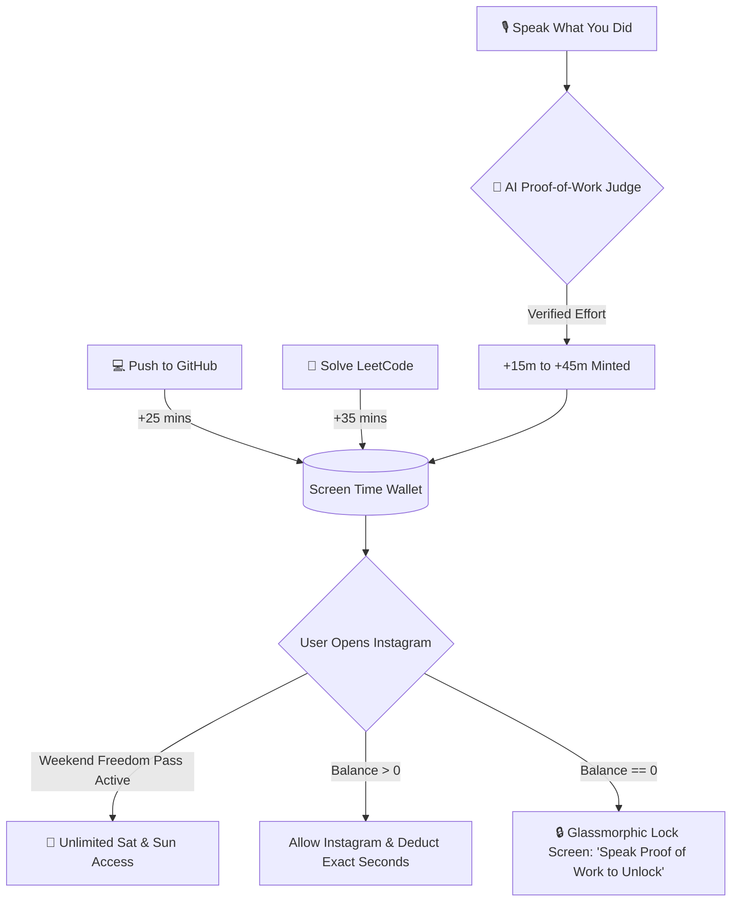

# 🎙️⚡ ProofOfWork

**Speak your Proof of Work. Earn your dopamine. Lock distractions behind verified voice & code.**

A native, zero-battery-drain Android productivity app that blocks social media (Instagram) until you earn screen time by **speaking what you accomplished via Voice Dictation**, **pushing code to GitHub**, **solving LeetCode problems**, and maintaining a **5-Day Weekday Streak for Weekend Freedom**.

[](https://developer.android.com)
[](https://wisprflow.ai)
[](https://ai.google.dev)
[](https://kotlinlang.org)
[](https://developer.android.com/jetpack/compose)

---

## 💡 The Philosophy: "The Voice-Driven Screen Time Economy"

Traditional app blockers fail because they rely on rigid schedules or manual checklists that feel like a chore to type.

**ProofOfWork** turns productivity into a **hands-free, voice-first economy**:
* **Say "Hey Productivity" / Tap the Mic:** Trigger the app via the Quick Settings Tile, Voice Assistant shortcut, or right from the Instagram Lock Screen.
* **Speak What You Accomplished:** Dictate naturally using Voice Dictation / Wispr Flow (e.g., *"I just spent 45 minutes refactoring the authentication API and wrote 3 unit tests"*).
* **AI Proof-of-Work Judge:** Our dual-engine verifier (**Google Gemini 2.0 Flash** + **Built-in Semantic AI Engine**) analyzes your wording, filters out filler words and fake claims, categorizes the effort (`CODING`, `STUDY`, `FITNESS`, `DEEP_WORK`), and **mints Instagram minutes** directly into your wallet.
* **5-Day Weekday Streak → Weekend Freedom Pass:** Complete at least 1 proof of work Monday through Friday to unlock **Unrestricted Saturday & Sunday Access**—with a 1-tap customizable toggle to switch between *Full Weekend Freedom* and *Normal Strict Daily Mode* anytime.



---

## ✨ Key Features

### 1. 🎙️ "Hey Productivity" Voice Proof-of-Work
* **Hands-Free Launchers:**
  * **Android Quick Settings Tile (`WisprVoiceTileService`):** Swipe down from any screen and tap **"🎤 Voice Proof"** to jump straight into voice logging.
  * **Digital Assistant / Voice Command Intent:** Responds to `ACTION_VOICE_COMMAND` & `ACTION_ASSIST` plus long-press App Shortcuts.
  * **Instagram Lock Screen Voice Unlock:** Locked out of Instagram? Tap **"Speak Proof of Work"** right on the barrier, dictate your completed task, and watch the lock screen automatically dismiss as your minutes are minted!
* **Automated Speech Formatting & Dictation Metrics:**
  * Automatically strips filler words (*"um"*, *"uh"*, *"like"*), cleans syntax, tracks words spoken, and verifies authentic work.

### 2. 🤖 Dual-Engine LLM Proof-of-Work Judge
* **Cloud LLM (Google Gemini 2.0 Flash) + Instant Offline Semantic AI:**
  * Evaluates spoken transcripts to verify genuine task completion and reject non-productive excuses (*"I did nothing"*, *"Watched Netflix"*).
  * Extracts concise task summaries, estimates focus duration, computes confidence scores, and delivers personalized coach feedback.
* **Custom Task → Instagram Minutes Mapping:**
  * Map specific task categories (`Coding`, `Study`, `Fitness`, `Deep Work`) or individual priority tasks to custom Instagram minute rewards (`+10m`, `+15m`, `+25m`, `+45m`).

### 3. 🔥 5-Day Weekday Streak & Customizable Weekend Freedom Mode
* **Mon–Fri Progress Tracker:** Visual 5-day progress tracker (`MON • TUE • WED • THU • FRI`).
* **Customizable Weekend Toggle:**
  * **ON (Weekend Freedom Pass):** Completing all 5 weekdays automatically grants **Unlimited Instagram Access** on Saturday and Sunday.
  * **OFF (Normal Mode):** Saturday and Sunday behave like normal weekdays requiring daily Proof of Work.
  * Includes a **`⚡ Test 5/5`** demo button to test the Weekend Freedom transition with a single tap on any day of the week!

### 4. 😅 "Voice Accountability Confession" & 📋 EOD Voice Standup
* **5-Minute Guilty Voice Confession:** Need an urgent 5-minute break without working? You must speak out loud why you are pausing focus and promise to return in 5 minutes.
* **1-Tap EOD Voice Standup Generator:** Compiles all your spoken logs, word counts, and coding verifications into a clean daily standup summary ready to copy into Slack, Notion, or Discord.

### 5. 🔋 Zero-Battery Millisecond Blocker Architecture
* **Timestamp Delta (`SystemClock.elapsedRealtime()`):** Zero polling loops in the background (0.0% idle CPU).
* **True to the Second:** Opening Instagram for 20 seconds deducts 20 seconds; switching to another app pauses deduction immediately.

---

## 🛠️ Tech Stack

| Layer | Technology |
| :--- | :--- |
| **Language** | Kotlin 2.0.21 |
| **Voice & AI** | Voice Dictation (Wispr Flow / SpeechRecognizer) + Google Gemini 2.0 Flash API |
| **UI Framework** | Jetpack Compose (Material Design 3) • Obsidian OLED Bento UI |
| **Architecture** | MVVM + Unidirectional Data Flow (`StateFlow` / Coroutines) |
| **Local Storage** | Jetpack DataStore (Preferences) + Room Database 2.6.1 (`TaskEntity`, `VoiceLogEntity`) |
| **OS Integration** | `AccessibilityService` + `TileService` (Quick Settings) + App Shortcuts |

---

## 🚀 Fast Build & Deploy

```powershell
cd ProofOfWork
.\run.ps1
```

Or build manually via Gradle:
```bash
./gradlew assembleDebug
adb install -r app/build/outputs/apk/debug/app-debug.apk
```

---

## 📄 License
Open-source under the [MIT License](LICENSE).
